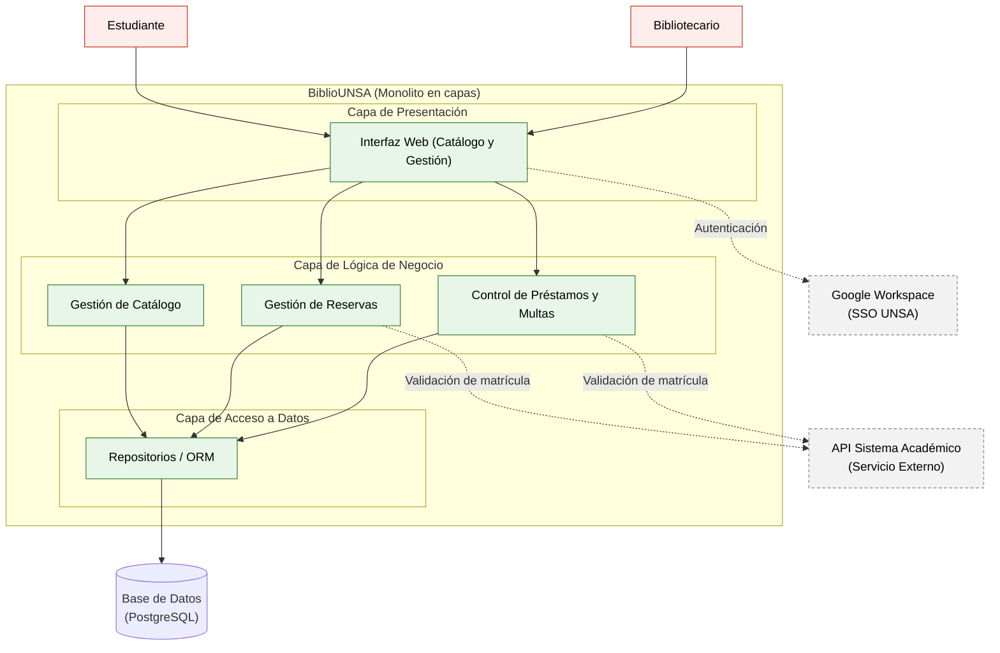
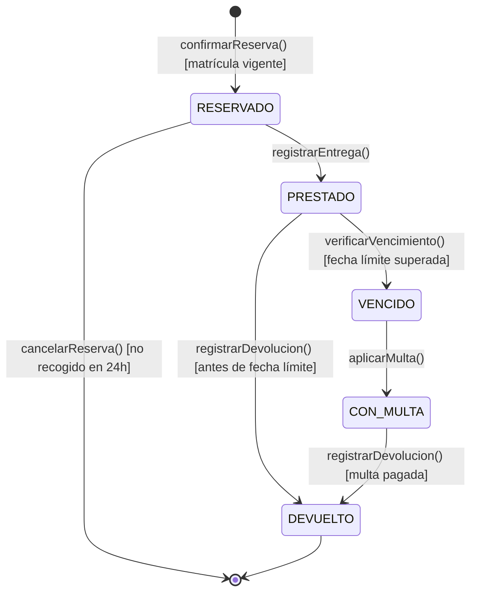
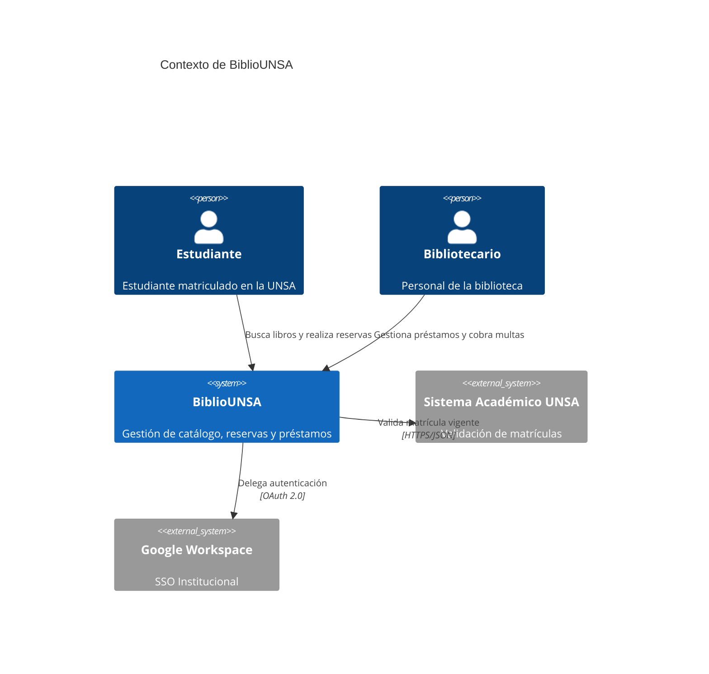
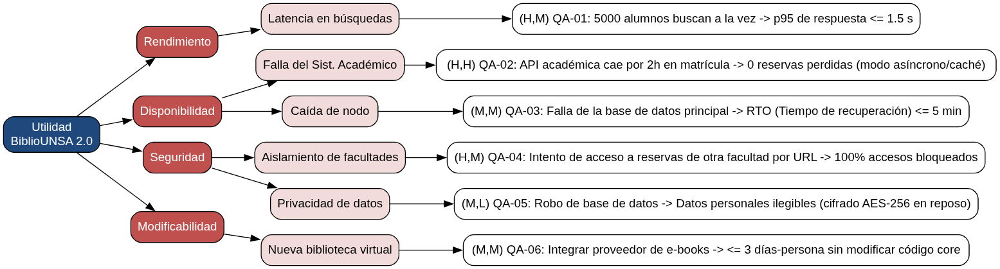

# BiblioUNSA - Laboratorio 04: Fundamentos de arquitectura de software
Construcción de Software - EPIS-UNSA

## Integrantes
- 2026-B Grupo 01
- William Choquehuanca Berna | Developer Full-Stack, Redactor de ADR, Diagramador y Verificador de IA

## Caso
El sistema BiblioUNSA permite gestionar el préstamo y la reserva de libros en las bibliotecas de la universidad. Los estudiantes pueden consultar el catálogo en línea y reservar textos, mientras que los bibliotecarios gestionan los préstamos mediante el escaneo de un carné QR y controlan las multas. El atributo de calidad crítico es la **Interoperabilidad**, ya que el sistema debe validar si la matrícula del estudiante está vigente consultando el sistema académico mediante una API externa, manteniendo la seguridad e independencia de los datos.

## Arquitectura elegida

## Decisiones arquitectónicas
- [ADR-001: Adoptar un monolito en capas para el MVP](docs/architecture/adr/001-estilo-arquitectonico.md)
- [ADR-002: Uso de OAuth 2.0 (Google Workspace) para autenticación](docs/architecture/adr/002-autenticacion-sso.md)
- [ADR-003: Uso de PostgreSQL como base de datos relacional](docs/architecture/adr/003-base-de-datos.md)

## Reflexión sobre el uso de la IA
El uso de asistentes de IA fue fundamental para agilizar la generación de diagramas como código y estructurar rápidamente la documentación de las decisiones. Sin embargo, la herramienta demostró un sesgo evidente hacia arquitecturas complejas, recomendando inicialmente un enfoque de microservicios. Como único desarrollador con un plazo de entrega de un mes y presupuesto nulo, aplicar esa recomendación habría llevado al fracaso operativo del proyecto. Esto subraya que la IA es excelente proponiendo y redactando, pero el juicio arquitectónico y la validación estricta contra las restricciones reales siguen siendo responsabilidad exclusiva del ingeniero.

## Diseño UML (Lab 05)

Como parte de la evolución de la arquitectura, se ha realizado el diseño detallado del módulo de Préstamos aplicando metodologías de **Diagram as Code** e **Ingeniería Inversa** con Python.

### Máquina de Estados: Ciclo de vida del Préstamo

### Enlaces a Entregables del Diseño
- 🏗️ **Estructural:** [Diagrama de Clases](docs/design/img/clases.png) y [Diagrama de Paquetes](docs/design/img/paquetes.png)
- ⚙️ **Comportamiento:** [Diagrama de Secuencia (Reserva)](docs/design/img/secuencia-reserva.png) y [Diagrama de Actividades (Devolución y Multa)](docs/design/img/actividades-devolucion.png)
- 🔄 **Auditoría e IA:** [Análisis Round-Trip](docs/design/round-trip.md), [Reporte de Consistencia C1-C5](docs/design/consistencia.md) y [Bitácora de IA](docs/design/bitacora-ia.md).

## Arquitectura C4 (Lab 06)

El diseño arquitectónico del sistema BiblioUNSA ha sido modelado utilizando el enfoque de "Arquitectura como Código" mediante Structurizr DSL, garantizando la consistencia entre los distintos niveles de abstracción.

### Nivel 1: Contexto del Sistema

### Enlaces a las 5 Vistas del Modelo C4
* 🌐 **Nivel 1 (Contexto):** [Ver diagrama de contexto](## Patrones de Diseño (Lab 07)

Se aplicó refactorización hacia patrones GoF guiada por pruebas de caracterización y métricas (radon).

### Resumen de Refactorización
| Olor detectado | Patrón Aplicado | Prueba de verificación |
| :--- | :--- | :--- |
| if/elif anidados sobre `reserva.estado` | **State** | `test_state_impide_transiciones_invalidas` |
| if/elif para cálculo de multas | **Strategy + Factory** | `test_open_closed_nuevo_tipo_sin_modificar_servicio` |
| SDK de la UNSA fuertemente acoplado | **Adapter** | Pruebas de caracterización originales |
| Notificaciones mezcladas en el servicio | **Observer** | `test_observer_nuevo_suscriptor_sin_tocar_el_servicio` |
| Consultas repetitivas a APIs | **Decorator** | `test_decorator_cache_evita_llamadas_repetidas` |
| IA generativa sin filtros | **Chain of Responsibility** | `test_chain_of_responsibility_bloquea_ia_alucinando` |

### Métricas de Complejidad (procesar_reserva)
| Métrica | Antes (Ingenua) | Después (Patrones) |
| :--- | :--- | :--- |
| **Complejidad (Radon)** | C (9) | A (2) |
| **Líneas de código** | ~60 | ~200 |docs/architecture/c4/img/structurizr-Contexto.png)
* 📦 **Nivel 2 (Contenedores):** [Ver diagrama de contenedores](docs/architecture/c4/img/structurizr-Contenedores.png)
* 🧩 **Nivel 3 (Componentes):** [Ver diagrama de componentes](docs/architecture/c4/img/structurizr-Componentes.png)
* 🔄 **Vista Dinámica (Reserva):** [Ver diagrama dinámico](docs/architecture/c4/img/structurizr-ReservaLibro.png)
* 🚀 **Vista de Despliegue:** [Ver diagrama de despliegue](docs/architecture/c4/img/structurizr-Despliegue.png)

### Auditoría y Documentación
* [Inventario de elementos](docs/architecture/c4/inventario.md)
* [Revisión con checklist C4](docs/architecture/c4/revision-c4.md)
* [Explicación para público no técnico](docs/architecture/c4/explicacion.md)
* [Bitácora de IA y falsos positivos](docs/architecture/c4/bitacora-ia.md)
* [Comparación Modelado vs Diagramación](docs/architecture/c4/comparacion.md)

## Patrones de Diseño (Lab 07)

Se aplicó refactorización hacia patrones GoF guiada por pruebas de caracterización y métricas (radon).

### Resumen de Refactorización
| Olor detectado | Patrón Aplicado | Prueba de verificación |
| :--- | :--- | :--- |
| if/elif anidados sobre `reserva.estado` | **State** | `test_state_impide_transiciones_invalidas` |
| if/elif para cálculo de multas | **Strategy + Factory** | `test_open_closed_nuevo_tipo_sin_modificar_servicio` |
| SDK de la UNSA fuertemente acoplado | **Adapter** | Pruebas de caracterización originales |
| Notificaciones mezcladas en el servicio | **Observer** | `test_observer_nuevo_suscriptor_sin_tocar_el_servicio` |
| Consultas repetitivas a APIs | **Decorator** | `test_decorator_cache_evita_llamadas_repetidas` |
| IA generativa sin filtros | **Chain of Responsibility** | `test_chain_of_responsibility_bloquea_ia_alucinando` |

### Métricas de Complejidad (procesar_reserva)
| Métrica | Antes (Ingenua) | Después (Patrones) |
| :--- | :--- | :--- |
| **Complejidad (Radon)** | C (9) | A (2) |
| **Líneas de código** | ~60 | ~200 |

## Diseño de la Arquitectura (Lab 08)

Se aplicó el método **Attribute-Driven Design (ADD 3.0)** para guiar la evolución de BiblioUNSA frente a su expansión a todas las facultades, validando cada decisión mediante simulaciones y *Fitness Functions*.

### Árbol de Utilidad (Priorización)

### Resumen de Iteraciones ADD
| Escenario Prioritario | Táctica Adoptada | Evidencia | ¿Cumple? | ADR |
| :--- | :--- | :--- | :--- | :--- |
| **QA-02:** Caída de API Académica | Circuit Breaker + Outbox en BD Local | Simulación de Caída (0 reservas perdidas). | Sí | [ADR-006](docs/architecture/adr/006-disponibilidad-api-academica.md) |
| **QA-01:** Búsquedas concurrentes | Optimizar Consultas (Índices) + Caché | Simulación M/G/c (p95 baja a 0.3s). | Sí | [ADR-007](docs/architecture/adr/007-rendimiento-busquedas.md) |
| **QA-04:** Aislamiento de Facultades | Row-Level Security (RLS) en PostgreSQL | Prueba de Integración / Fitness Function. | Sí | [ADR-008](docs/architecture/adr/008-aislamiento-facultades-rls.md) |