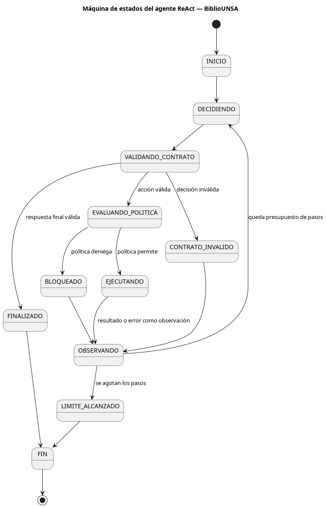

# Lab 10 — Sistemas agénticos

## E2: agente ReAct para ISSUE-01

Desde la raíz del repositorio, inicia el modo interactivo:

```bash
./.venv/bin/python -m agentes.agente.ejecutar
```

En cada paso, copia el contexto mostrado al asistente y pega una decisión JSON del protocolo. El agente valida la respuesta, aplica la política y guarda la trayectoria y la traza. No requiere claves de API.

Para generar el diagrama Mermaid desde `agentes/`:

```bash
../.venv/bin/python agente/traza.py
```

Artefactos del E2:

- `trayectorias/e2-issue-01.json`: respuestas y validación del contrato.
- `trazas/e2-issue-01.jsonl`: eventos de ejecución.
- `trazas/e2-issue-01.mmd`: diagrama de secuencia.

Para el informe, captura la salida de la prueba del ISSUE-01 fallando antes del cambio, la prueba aprobada después y el diagrama Mermaid. La suite completa aún incluye ISSUE-02 e ISSUE-03, pendientes de sus respectivos ejercicios.

## E3: estados y contrato

- `diseno/estados.puml`: máquina de estados del bucle ReAct.
- `diseno/estados.png`: render del diagrama para revisión e informe.
- `pruebas_agente/test_contrato.py`: decisiones válidas e inválidas para el contrato.
- `pruebas_agente/test_estados.py`: comprueba que la traza registra las transiciones previstas.

Ejecuta `./.venv/bin/pytest -q pruebas_agente` desde la raíz para validar E3. Para el informe, captura el diagrama de estados y el resultado de las pruebas de contrato.


